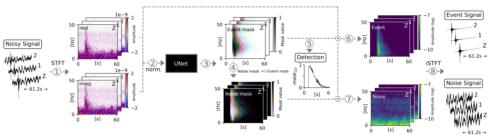
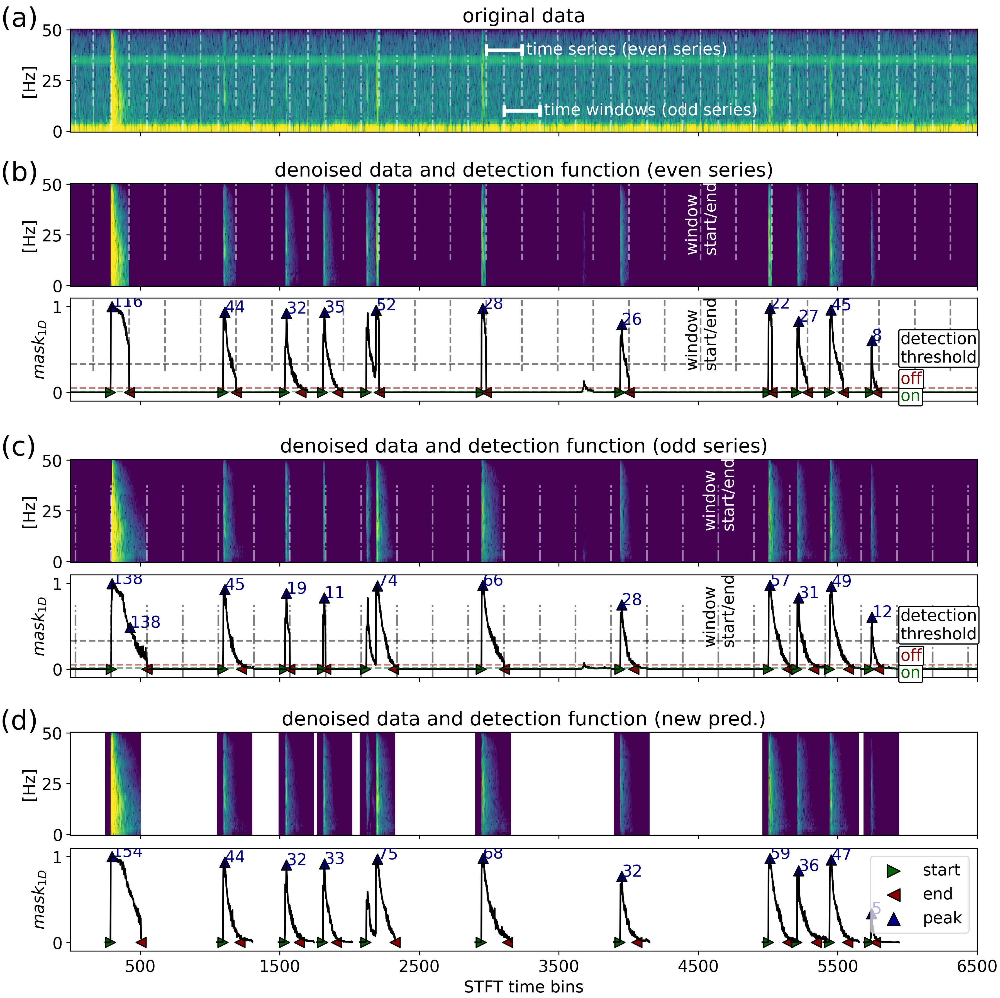
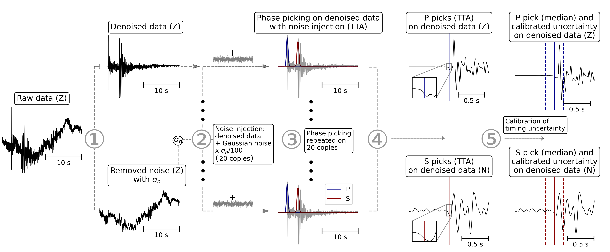

[](https://doi.org/10.5281/zenodo.17935346)

# Earthquake-Seismogram-Denoiser (EQS-Denoiser)

Created by: Niko Dahmen, ETH Zurich
Contact: nikolaj.dahmen@eaps.ethz.ch

Deep-learning denoising and signal detection for three-component seismic waveforms, intended for **post-processing of continuous data** (not real-time). A U-Net predicts time–frequency masks on the STFT of 3-C velocity records. The masks are used to detect earthquake signals and to reconstruct denoised waveforms. Denoised data can then be picked with SeisBench Picker (EQTransformer), using test-time augmentation (TTA) for pick uncertainties.

For details, see:

Dahmen, N., Clinton, J., Meier, M.-A., & Scarabello, L. (2026).
Towards Operational Earthquake Seismogram Denoising.
*Bulletin of the Seismological Society of America*. https://doi.org/10.1785/0120250198


***EQS-Denoiser workflow.** Dahmen et al., BSSA*

---

## Repository

| Path | Content |
|---|---|
| `Code/EQS-Denoiser_example.py` | Single 61.2 s window, step by step with plots (`# %%` cells) |
| `Code/DenoiseData_terminal_public.py` | Command line: continuous data → signal detection + denoising |
| `Code/Picking_public.py` | EQTransformer phase picking with TTA on denoised output |
| `Code/DenoisingFunctions_public.py` | Shared functions |
| `Code/requirements.txt` | Dependencies for denoising |
| `Code/requirements_with_picking.txt` | Dependencies for denoising + phase picking (adds seisbench, natsort) |
| `Models/model_1000k_onlyweights.keras` | Trained model from the paper |

---

## Environment Setup

Requires Python ≤ 3.12, because TensorFlow 2.17 does not support newer versions. Create and activate a virtual environment named `eqs`, then install the dependencies. For phase picking, use `Code/requirements_with_picking.txt` in place of `Code/requirements.txt`.

Linux:
```bash
git clone https://github.com/niko-d/EarthquakeSeismogramDenoiser.git
cd EarthquakeSeismogramDenoiser
python3 -m venv eqs
source eqs/bin/activate
pip install --upgrade pip
pip install -r Code/requirements.txt
```

---

## 1. Single time window denoising

[EQS-Denoiser_example.py](Code/EQS-Denoiser_example.py) runs one 61.2 s window step by step: it downloads and preprocesses the data, computes the STFT, predicts the masks and plots each step, for initial testing and visualising single time windows. The script is organised in `# %%` cells for VS Code, Spyder or PyCharm.

Before running it, change the `/Material/...` model and module paths at the top of the script to match your checkout.

---

## 2. Denoising and signal detection on continuous data

[DenoiseData_terminal_public.py](Code/DenoiseData_terminal_public.py) splits the time span into 61.2 s windows with 50 % overlap. Signals are detected on the predicted mask time series. For each detection, the waveform from the window with the higher detection score is kept. Only the detected signal windows are saved.


***Continuous Data Denoising.** Dahmen et al., BSSA*

Example: download data from the "ETH" FDSN client, preprocess, detect signals and denoise 600 s starting at 2025-02-07T17:00:00. Both raw and denoised data are saved.
```bash
cd Code
python ./DenoiseData_terminal_public.py CH MFERR HH 2025-02-07T17:00:00 600 --saveraw True --model_name ../Models/model_1000k_onlyweights.keras --client_str ETH --min_peak_height 0.33
```

### Command-line arguments

Required:

| Argument | Type | Description |
|---|---|---|
| `network` | str | Seismic network code, e.g. `CH` |
| `station` | str | Seismic station code, e.g. `MFERR` |
| `channel` | str | Band + instrument code **without** the component, e.g. `HH`, `HG`, `EH` (`?` is appended automatically) |
| `start_time` | str | UTC **start** time of the data segment, e.g. `2025-02-07T17:00:00` |
| `duration` | float | Duration of the data segment in seconds |

Optional:

| Argument | Type | Default | Description |
|---|---|---|---|
| `--model_name` | str | – | Path to the trained model file, e.g. `../Models/model_1000k_onlyweights.keras`. **Always set.** |
| `--client_str` | str | – | ObsPy [FDSN client](https://docs.obspy.org/packages/obspy.clients.fdsn.html), e.g. `ETH`. **Always set.** |
| `--min_peak_height` | float | None | Main detection threshold. Peak-detection threshold (0–1) on the mask time series. **Set to 0.33 in the study.** |
| `--threshold` | float | 10.0 | Secondary detection-score threshold for collecting detections, set to a low value. Changing it is not recommended. |
| `--saveraw` | str | "False" | Set to `True` to also save the preprocessed raw data |
| `--verbose` | flag | off | Enable verbose output (no value needed) |

### Preprocessing (applied automatically)

1. Data is downloaded with a buffer on both sides.
2. Channel selection (if argument matches several instruments): `HH` is preferred over `HG`, and `HG` over `EH`. Channels below 100 Hz are dropped, and the first location code is used.
3. The instrument response is removed to velocity, with pre-filter 0.01 / 0.05 / 45 / 50 Hz.
4. The data is resampled to 100 Hz if the sampling rate is higher.

### Output

Files are written to a folder `DOY<day-of-year>/` **inside the model's folder**. For the example above, that is `Models/DOY038/`.

- `NET.STA.LOC.CH_denoised.mseed`: denoised waveforms of the detected signal windows
- `NET.STA.LOC.CH_original.mseed`: preprocessed raw data (only with `--saveraw True`)

After writing the files, the script plots the denoised and the preprocessed streams.

---

## 3. Phase picking on denoised data with Test Time Augmentation


***Phase Picking with Test Time Augmentation.** Dahmen et al., BSSA*

[Picking_public.py](Code/Picking_public.py) picks P and S phases with EQTransformer (SeisBench, `ethz` weights) on the denoised data. Timing uncertainty is estimated by picking on several noise-augmented waveforms and scaling the variation of the picks to an uncertainty; the median pick is reported.

   Requires `Code/requirements_with_picking.txt` and the output of step 2 run with `--saveraw True`. Set the input paths and `start` at the top of the script to the step-2 output folder and start time, then run `python Picking_public.py`.
   
Main settings of `process_stream`:

| Parameter | Default | Description |
|---|---|---|
| `repeat` | 20 | Number of TTA repetitions |
| `pick_tolerance` | 1 | Picks within ± this value (s) are treated as the same pick |
| `p_confidence`, `s_confidence` | 0.5 | EQTransformer confidence threshold |
| `min_share_models` | 0.25 | Share of noise-augmented waveforms with agreeing picks exceeding the confidence threshold |

The picks are collected in `all_results["p_picks"]` and `all_results["s_picks"]`. Because random noise is added, picks can vary slightly between runs if not seeded. A larger `repeat`, or a fixed random noise, gives more stable results. Distributing picking on several workers can lead to variations in output.

---

## Model

- Architecture: U-Net (Keras 3)
- Input: 3 components (Z first), velocity, 100 Hz, 6120 samples (61.2 s)
- STFT: `nperseg=48`, `noverlap=24`, `nfft=126`, giving 64 × 256 bins with the real and imaginary parts of each component as separate channels
- Normalisation: per component, by the 25th–75th percentile range
- Output: one mask per component (64 × 256 × 3)

Performance outside the instrument types, earthquake distance and magnitude range, and settings described in the paper has not been tested.

---

## Citation

If you use this code, please cite the paper and the software ([Zenodo](https://doi.org/10.5281/zenodo.17935346)).

```bibtex
@article{dahmen_eqsdenoiser,
  author  = {Dahmen, Nikolaj and Clinton, John and Meier, Men-Andrin and Scarabello, Luca},
  title   = {Towards Operational Earthquake Seismogram Denoising},
  journal = {Bulletin of the Seismological Society of America},
  year    = {2026},
  doi     = {10.1785/0120250198}
}

@software{dahmen_eqsdenoiser_code,
  author = {Dahmen, Nikolaj and Clinton, John and Meier, Men-Andrin and Scarabello, Luca},
  title  = {Earthquake-Seismogram-Denoiser},
  doi    = {10.5281/zenodo.17935346},
  url    = {https://github.com/niko-d/EarthquakeSeismogramDenoiser}
}
```

## License

MIT License, see [LICENSE](LICENSE).

---

<table>
<tr>
<td width="70%" valign="middle">

### TRANSFORM² Project

This work is part of the **TRANSFORM² project**, which aims to improve physical and digital infrastructure across Near-Fault Observatories (NFOs) in Europe.

TRANSFORM² is funded by the **European Union** under project number **101188365**, within the **HORIZON-INFRA-2024-DEV-01-01** call.

</td>
<td width="30%" align="center" valign="middle">


</td>
</tr>
</table>

---
